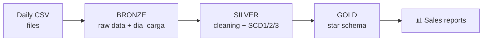

# 🏬 Retail Data Warehouse — Databricks + SQL (Medallion Architecture)

Course project (Data Warehouse, Instituto Tecnológico de Costa Rica) that builds a
**Medallion-architecture data warehouse** in Databricks using Spark SQL and Delta Lake. Daily CSV
files are ingested into **Bronze**, cleaned and versioned in **Silver**, and served as a
**Kimball star schema** in **Gold**, handling data that changes over time (customers who move,
products that change brand, branches that change manager) without losing or duplicating history.

## 📌 The problem it solves

A retail chain needs to answer questions like *"which product categories sell the most in each
region?"*, but its data arrives every day in separate files (customers, products, branches, sales)
and some of it **changes over time**. Without a proper process, those changes lead to inconsistent
reports or lost history.

## 🏗️ Architecture



- **Bronze:** raw ingestion of the CSV files, untransformed. Each daily load is tagged with `dia_carga` (load day).
- **Silver:** cleaning, typing and **Slowly Changing Dimensions (SCD)**.
- **Gold:** star schema ready for Power BI, Tableau or any reporting tool.

## 🔑 Slowly Changing Dimensions

| Dimension | Possible change | Technique | Why |
|---|---|---|---|
| Branch (Sucursal) | Manager changes | **SCD1** (overwrite) | The previous manager does not matter |
| Customer (Cliente) | City / country / email changes | **SCD2** (history with validity dates) | We need to know where the customer lived at the time of each past sale |
| Product (Producto) | Brand changes | **SCD3** (previous value) | Only the current vs. previous brand matters |

Implementation details:

- **Incremental loads** with `MERGE INTO`. Each day can be re-run without creating duplicates
  (idempotent), as long as days are processed in order.
- **SCD2 in a single `MERGE`:** closes the previous version (`FechaFin`, `Activo = false`) and inserts the new
  one. Each version has its own surrogate key (`ClienteSK`).
- **Validity dates** are defined in the `silver_config_cargas` table instead of being hard-coded.
- **Null-safe comparisons** (`<=>`): a change to or from `NULL` is also detected.
- **Point-in-time join in Gold:** each sale joins to the customer version valid on the purchase date
  (`FechaInicio <= FechaVenta < FechaFin`). The second report compares the customer's country *at the
  time of sale* with their *current* country; if the results differ, the SCD2 history is adding value.

## 🛠️ Tech

- **Databricks:** Spark SQL on Delta Lake, Unity Catalog, volumes
- **SQL:** DDL, `MERGE INTO`, `QUALIFY`, window functions, `read_files`
- **Medallion architecture** and dimensional modeling (star schema, surrogate keys)

## 📂 Repository contents

```
├── 01_bronze.sql          # Catalog, schemas, volume and CSV ingestion with dia_carga
├── 02_silver_scd.sql      # Cleaning + SCD1, SCD2 and SCD3 (incremental load by day)
├── 03_gold_y_reporte.sql  # Star schema, point-in-time join and reports
├── 04_validaciones.sql    # Data-quality checks (duplicates, overlaps, amount reconciliation)
└── README.md
```

Table and column names are in Spanish because they come from the course dataset
(for example `Cliente` = customer, `Sucursal` = branch, `Ventas` = sales).

## ▶️ How to run

1. In Databricks, upload the CSV files to the volume `/Volumes/invest2_catalog/invest2_bronze/raw_data/`
   (file names are listed in the header of `01_bronze.sql`).
2. Run `01_bronze.sql` in full.
3. In `02_silver_scd.sql`, run the **SETUP** section once, then the **PROCESS ONE DAY** section with
   `process_day = 1`, `2` and `3` (in that order).
4. Run `03_gold_y_reporte.sql` and review the reports.
5. Run `04_validaciones.sql`; each query states its expected result.

**Data:** the CSV files come from the course and are not included in this repository. Expected structure:

| File | Columns used |
|---|---|
| Dimensión Clientes d1/d2/d3 | `ClienteKey, NombreCliente, Ciudad, Region, Pais, Email` |
| Dimensión Productos d1/d2 | `ProductoKey, NombreProducto, Subcategoria, Categoria, Marca` |
| Dimensión Sucursales d1/d2 | `SucursalKey, NombreSucursal, Region, Gerente` |
| Hechos Ventas d1 d2 d3 | `FechaKey (yyyyMMdd), ProductoKey, ClienteKey, SucursalKey, CantidadVendida, MontoVenta` |

## 📊 Sample result

Sales by category, region and branch using the course data (small volume):

| Category | Region | Branch | Units | Total Sales |
|---|---|---|---|---|
| Tecnología | Central | Sucursal Centro | 81 | $81,000.00 |
| Tecnología | Occidente | Sucursal Oeste | 54 | $27,000.00 |
| Tecnología | Central | Sucursal Este | 27 | $24,300.00 |

## ⚠️ Known limitations

- Academic project on a small dataset; not tested at scale and not orchestrated (no Airflow, Workflows
  or CI/CD).
- Days must be processed in order; reprocessing an earlier day after a later one is not supported.
- The day-3 validity date (`2025-03-01`) and the `yyyyMMdd` format of `FechaKey` are assumptions that can
  be configured (see `silver_config_cargas` and `silver_factventas`).
- `NombreCliente` does not create a new SCD2 version (only city, region, country and email do).

## 👤 Author

**Gerardo Porras** — Data Analysis student, Instituto Tecnológico de Costa Rica (TEC).
Built as part of the Data Warehouse course (TEC), adapted and documented for my portfolio.

---

### Resumen en español

Proyecto del curso de Data Warehouse (TEC): pipeline Medallion en Databricks (Bronze → Silver → Gold) con
SCD tipo 1, 2 y 3 mediante `MERGE INTO` incremental, un esquema estrella en Gold donde cada venta se une a la
versión del cliente vigente en la fecha de compra, y validaciones de calidad. Los CSV son del curso y no se
incluyen; las columnas esperadas están en la tabla de arriba.
